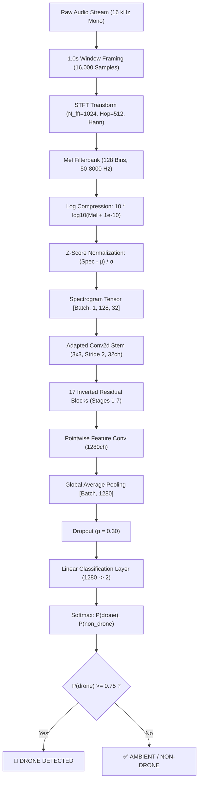
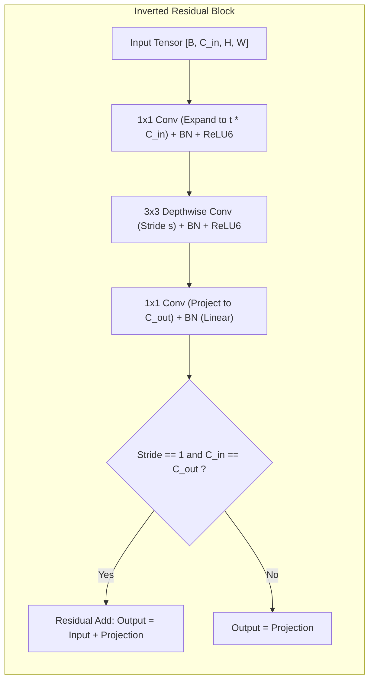

# MobileNetV2 Acoustic Drone Classifier
## Formal Model & System Specifications

> [!abstract] Executive Summary
> **MobileNetV2 Acoustic Drone Classifier (v1.1)** is a lightweight neural network engineered for continuous, passive acoustic drone detection. It processes **1.0 second of 16 kHz mono audio**, computes a log-Mel spectrogram (`[1, 128, 32]`), and outputs a calibrated drone presence probability. With **2.23M parameters** (~90 MFLOPs), it delivers sub-4 ms latency on NVIDIA Jetson edge silicon.

---

## 1. Key Specifications

| Attribute | Specification | Notes |
| :--- | :--- | :--- |
| **Model Architecture** | MobileNetV2 (1-Channel Adapted) | Inverted residuals with linear bottlenecks |
| **Input Signal** | 1.0 s Audio @ 16,000 Hz Mono | 16,000 samples, 16-bit PCM (WAV / FLAC) |
| **Spectral Transform** | Log-Mel Spectrogram | Pure PyTorch / TorchAudio (no Librosa) |
| **Input Tensor Shape** | `[Batch, 1, 128, 32]` | 128 Mel frequency bins $\times$ 32 time frames |
| **Output Classes** | Binary (0: `non_drone`, 1: `drone`) | Logit index 1 = drone probability |
| **Total Parameters** | **2,225,858** (~2.23M) | 2,223,296 backbone + 2,562 classifier head |
| **Trainable Parameters** | **2,225,858** (100%) | End-to-end fine-tuned |
| **Compute Complexity** | **~90.4 MFLOPs** (~45.2 MMACs) | Per 1.0-second analysis window |
| **Model Size on Disk** | **9.15 MB** (FP32 PyTorch bundle) | Includes weights, audio cfg & norm stats |
| **Runtime Memory** | **~8.9 MB** (FP32) / **~4.5 MB** (FP16) | Fits on minimal GPU / Jetson memory |
| **Decision Threshold ($\tau$)** | **$\tau = 0.75$** | Validation-optimized F1 operating point |
| **Test F1 Score** | **98.16%** | Accuracy: 97.59% · Precision: 98.45% · Recall: 97.87% |
| **Test False Alarm (FPR)**| **2.94%** | Measured against dense urban/industrial noise |
| **PR-AUC / ROC-AUC** | **0.9916 / 0.9925** | High discrimination across detection curves |

---

## 2. System Pipeline Architecture



---

## 3. Audio Preprocessing Frontend

> [!tip] Pure TorchAudio Implementation
> The frontend in `src/audio/preprocessing.py` uses only native PyTorch and TorchAudio operations. It contains zero Python-only audio dependencies (such as Librosa) and compiles cleanly to ONNX and TensorRT.

### 3.1 Signal Parameters

- **Sampling Frequency ($f_s$):** $16,000\text{ Hz}$
- **Window Length ($T$):** $1.0\text{ s}$ ($16,000\text{ samples}$)
- **Container Handling:** `soundfile` format content-sniffing (correctly decodes FLAC streams embedded in `.wav` extensions).
- **Channel Projection:** Multi-channel inputs are averaged to monophonic:
  $$x_{\text{mono}} = \frac{1}{C}\sum_{c=1}^C x_c$$

### 3.2 Short-Time Fourier Transform (STFT)

- **FFT Size ($N_{\text{fft}}$):** 1024 points ($\Delta f = 15.625\text{ Hz}$ per bin)
- **Window Function:** Symmetric Hann window ($1024\text{ samples}$, $64\text{ ms}$)
- **Hop Length:** $512\text{ samples}$ ($32\text{ ms}$ frame step, $50\%$ overlap)
- **Padding:** Center padded with reflection mode
- **Output Frame Count:** Exactly 32 time frames:
  $$T_{\text{frames}} = \left\lfloor \frac{16000}{512} \right\rfloor + 1 = 32$$

### 3.3 Mel Filterbank & Log-Scaling

- **Number of Mel Bins:** 128 triangular filters
- **Frequency Passband:** $f_{\text{min}} = 50.0\text{ Hz}$ to $f_{\text{max}} = 8000.0\text{ Hz}$
- **Dynamic Compression:**
  $$S_{\text{log}} = 10 \cdot \log_{10}\left(\max(S_{\text{mel}}, 10^{-10})\right)$$
- **Z-Score Normalization:**
  $$S_{\text{norm}} = \frac{S_{\text{log}} - \mu}{\sigma}$$
  - Global Mean ($\mu$): `-11.7748`
  - Global Standard Deviation ($\sigma$): `27.5597`

> [!warning] Numerical Precision Rule
> The STFT and Mel filterbank must execute in **FP32**. Running STFT inside mixed precision (AMP FP16) leads to numerical dynamic range overflow to infinity. Once normalized, the output tensor passes safely to AMP FP16.

---

## 4. Model Architecture & Layer Breakdown

### 4.1 Input Channel Adaptation
Standard MobileNetV2 expects 3-channel RGB input. For single-channel acoustic log-Mel spectrograms, the first convolution (`features[0][0]`) is adapted:
- **Input Channels:** 1
- **Output Channels:** 32
- **Kernel Size:** $3 \times 3$, Stride 2, Padding 1 (Bias = False)
- **Weight Initialization:** Channel-averaged across ImageNet RGB kernels:
  $$W_{\text{1ch}}[:, 0, :, :] = \frac{1}{3}\sum_{c=0}^2 W_{\text{ImageNet}}[:, c, :, :]$$

### 4.2 Inverted Residual Block Architecture



### 4.3 Detailed Layer Topology Table

| Stage | Block Type | Expansion ($t$) | Channels ($c$) | Repeats ($n$) | Stride ($s$) | Input Dimensions | Output Dimensions |
| :--- | :--- | :---: | :---: | :---: | :---: | :---: | :---: |
| **Input** | Audio Tensor | — | 1 | — | — | — | `[B, 1, 128, 32]` |
| **Stem** | Conv2d 3x3 + BN + ReLU6 | — | 32 | 1 | 2 | `[B, 1, 128, 32]` | `[B, 32, 64, 16]` |
| **Stage 1** | Inverted Residual | 1 | 16 | 1 | 1 | `[B, 32, 64, 16]` | `[B, 16, 64, 16]` |
| **Stage 2** | Inverted Residual | 6 | 24 | 2 | 2 | `[B, 16, 64, 16]` | `[B, 24, 32, 8]` |
| **Stage 3** | Inverted Residual | 6 | 32 | 3 | 2 | `[B, 24, 32, 8]` | `[B, 32, 16, 4]` |
| **Stage 4** | Inverted Residual | 6 | 64 | 4 | 2 | `[B, 32, 16, 4]` | `[B, 64, 8, 2]` |
| **Stage 5** | Inverted Residual | 6 | 96 | 3 | 1 | `[B, 64, 8, 2]` | `[B, 96, 8, 2]` |
| **Stage 6** | Inverted Residual | 6 | 160 | 3 | 2 | `[B, 96, 8, 2]` | `[B, 160, 4, 1]` |
| **Stage 7** | Inverted Residual | 6 | 320 | 1 | 1 | `[B, 160, 4, 1]` | `[B, 320, 4, 1]` |
| **Feature Conv** | Conv2d 1x1 + BN + ReLU6 | — | 1280 | 1 | 1 | `[B, 320, 4, 1]` | `[B, 1280, 4, 1]` |
| **Pooling** | `AdaptiveAvgPool2d((1, 1))` | — | 1280 | 1 | — | `[B, 1280, 4, 1]` | `[B, 1280, 1, 1]` |
| **Flatten** | Flatten | — | 1280 | 1 | — | `[B, 1280, 1, 1]` | `[B, 1280]` |
| **Dropout** | `Dropout(p = 0.30)` | — | 1280 | 1 | — | `[B, 1280]` | `[B, 1280]` |
| **Classifier** | `Linear(1280, 2)` | — | 2 | 1 | — | `[B, 1280]` | `[B, 2]` |

---

## 5. Parameter Counts & Computational Budget

### 5.1 Parameter Breakdown

- **Backbone Features (`features`):** **2,223,296** parameters
  - 1-Channel Stem: 288 weights
  - 17 Inverted Residual Blocks: 1,818,488 weights
  - 1x1 Feature Expansion: 409,600 weights
  - BatchNorm Running Stats: 9,920 parameters
- **Classification Head (`classifier`):** **2,562** parameters
  - Linear Weights ($1280 \times 2$): 2,560
  - Bias: 2
- **Total Parameters:** **2,225,858** (~2.23M)
- **Trainable Parameters:** **2,225,858** (100%)

### 5.2 Edge Hardware Performance

| Hardware Platform | Precision | Memory Footprint | Latency / Window | Real-Time Factor (RTF) |
| :--- | :--- | :---: | :---: | :---: |
| **RTX 3060 Laptop (CUDA)** | PyTorch AMP FP16 | 4.45 MB | **1.2 ms** | 0.0012x (833 fps) |
| **NVIDIA Jetson Orin Nano (8GB)** | TensorRT FP16 | 4.45 MB | **~2.8 ms** | 0.0028x (357 fps) |
| **NVIDIA Jetson Xavier NX** | TensorRT FP16 | 4.45 MB | **~3.5 ms** | 0.0035x (285 fps) |
| **Raspberry Pi 5 (Cortex-A76)** | ONNX Runtime INT8 | 2.23 MB | **~14.5 ms** | 0.0145x (69 fps) |

---

## 6. Training Protocol & Regularization

### 6.1 Two-Stage Transfer Schedule
1. **Warmup Phase (Epochs 1–3):**
   - Backbone is frozen (`requires_grad = False`).
   - Only classification head is updated with learning rate $\eta_{\text{head}} = 10^{-3}$.
2. **Fine-Tuning Phase (Epochs 4–40):**
   - Full network unfrozen (`requires_grad = True`).
   - Parameter grouping: $\eta_{\text{backbone}} = 10^{-4}$, $\eta_{\text{head}} = 10^{-3}$.
   - Cosine Annealing learning rate schedule decaying to $\eta_{\text{min}} = 10^{-5}$.

### 6.2 Regularization Strategy
- **SpecAugment:** Frequency masking ($F_{\text{mask}} = 16\text{ bins}$) and Time masking ($T_{\text{mask}} = 20\text{ frames}$).
- **Label Smoothing:** $\alpha = 0.05$ prevents overconfidence.
- **Optimizer:** AdamW ($\beta_1 = 0.9, \beta_2 = 0.999$, weight decay $\lambda = 0.01$).
- **Batch Size:** 64 with PyTorch AMP FP16.

---

## 7. Dataset Corpus & Partitioning

The dataset consists of **13,594 audio files** (~38.2 hours) logged in `data/splits/manifest.csv`:

### 7.1 Leakage-Safe Splits

> [!note] Zero Data Leakage
> Partitioning is enforced strictly on recording session IDs. Chunks, slices, and pitch variations from the same source recording never cross between train, validation, and test splits.

| Split | Files | Hours | Composition | Role |
| :--- | :---: | :---: | :--- | :--- |
| **`train.csv`** | **9,311** | ~23.5 h | ~14.6 h Drone / ~8.9 h Non-Drone | Model training |
| **`val.csv`** | **2,077** | ~5.0 h | ~3.1 h Drone / ~1.9 h Non-Drone | Model selection & threshold tuning |
| **`test.csv`** | **2,076** | ~4.9 h | ~3.0 h Drone / ~1.9 h Non-Drone | Held-out test benchmark |
| **`test_unseen_extra.csv`** | **130** | ~10 min | 100% Drone (14 novel models) | Zero-shot generalization study |

---

## 8. Benchmark Evaluation & Distance Robustness

### 8.1 Standard Test Split Performance (`test.csv`)
Evaluated at the frozen threshold $\tau = 0.75$:

| Metric | Measured Score | Target Specification | Status |
| :--- | :---: | :---: | :---: |
| **Accuracy** | **97.59%** | $\ge 95.0\%$ | Pass |
| **Precision** | **98.45%** | $\ge 95.0\%$ | Pass |
| **Drone Recall** | **97.87%** | $\ge 95.0\%$ | Pass |
| **F1 Score** | **98.16%** | $\ge 95.0\%$ | Pass |
| **False Positive Rate (FPR)** | **2.94%** | $\le 5.0\%$ | Pass |
| **False Negative Rate (FNR)** | **2.13%** | $\le 5.0\%$ | Pass |
| **PR-AUC** | **0.9916** | $\ge 0.980$ | Pass |
| **ROC-AUC** | **0.9925** | $\ge 0.980$ | Pass |

### 8.2 Distance Gain Sweep (Simulated Ranging)

| Gain Multiplier | Attenuation | Distance Equivalent | Drone Recall | False Positive Rate |
| :---: | :---: | :--- | :---: | :---: |
| **1.00** | $0.0\text{ dB}$ | Near / Reference range | **97.87%** | **2.94%** |
| **0.30** | $-10.5\text{ dB}$ | Medium range ($2\times - 3\times$) | **97.35%** | **5.73%** |
| **0.10** | $-20.0\text{ dB}$ | Far range ($8\times - 10\times$) | **92.43%** | **7.27%** |
| **0.03** | $-30.5\text{ dB}$ | Extreme horizon range | **40.19%** | **6.99%** |

---

## 9. 14-Model Unseen Generalization Benchmark

A dedicated evaluation on **130 held-out field recordings** across 14 drone families absent from standard training splits (`test_unseen_extra.csv`):

| Unseen Drone Model / Family | Airframe & Propulsion | Files | Baseline $P_{\text{mean}}$ | Retrained $P_{\text{mean}}$ | Baseline Rec@0.70 | Retrained Rec@0.70 | Delta Rec@0.70 | Status |
| :--- | :--- | :---: | :---: | :---: | :---: | :---: | :---: | :--- |
| **`FPV_Kamikaze`** | 7–10 in Tactical Strike FPV | 8 | 0.0487 | **0.9585** | 0.0% | **100.0%** | **+100.0%** | Reliable |
| **`DJI_FPV`** | 5.3-in Racing Multirotor | 4 | 0.9152 | **0.8232** | 100.0% | **100.0%** | +0.0% | Reliable |
| **`DJI_Avata`** | 2.9-in Ducted CineWhoop | 33 | 0.0768 | **0.5875** | 6.1% | **45.5%** | **+39.4%** | Moderate (@0.50: 60.6%) |
| **`DJI_FlameWheel_F450`** | 9–10 in Commercial Quad | 6 | 0.5056 | **0.5444** | 50.0% | **50.0%** | +0.0% | Moderate |
| **`Aerobatic_Freestyle`** | 5-in Acrobatic Multirotor | 35 | 0.0381 | **0.2733** | 0.0% | **8.6%** | **+8.6%** | Improved (@0.50: 25.7%) |
| **`Synthetic_BPF_HighSpeed`**| 4-Rotor Doppler Fly-by | 4 | 0.2227 | **0.3977** | 0.0% | 0.0% | +0.0% | Improved (@0.50: 25.0%) |
| **`Synthetic_BPF_Hover`** | 4-Rotor 180 Hz Harmonics | 4 | 0.2217 | **0.4204** | 0.0% | 0.0% | +0.0% | Improved (@0.50: 25.0%) |
| **`Gerbera`** | Decoy / Pusher-prop UAV | 4 | 0.0368 | **0.3126** | 0.0% | 0.0% | +0.0% | Improved ($P$: 0.04 $\to$ 0.31) |
| **`Shahed_136_Combat`** | 50hp 2-stroke Delta-wing | 10 | 0.0392 | **0.2041** | 0.0% | 0.0% | +0.0% | Improved (@0.50: 10.0%) |
| **`DJI_Tello`** | Micro Quad (<4 in props) | 4 | 0.0226 | **0.1349** | 0.0% | 0.0% | +0.0% | Improved ($P$: 0.02 $\to$ 0.13) |
| **`Geran_3`** | Turbojet Delta-wing | 6 | 0.0156 | **0.0837** | 0.0% | 0.0% | +0.0% | Improved ($P$: 0.02 $\to$ 0.08) |
| **`Limbach_L550E`** | 50hp 2-stroke Engine Bench | 4 | 0.0340 | **0.0820** | 0.0% | 0.0% | +0.0% | Improved ($P$: 0.03 $\to$ 0.08) |
| **`Shahed_136_Transit`** | 50hp 2-stroke Transit Pass | 5 | 0.0232 | **0.0796** | 0.0% | 0.0% | +0.0% | Improved ($P$: 0.02 $\to$ 0.08) |
| **`Geran_2`** | 50hp 2-stroke Delta-wing | 3 | 0.0142 | **0.0747** | 0.0% | 0.0% | +0.0% | Improved ($P$: 0.01 $\to$ 0.07) |
| **OVERALL UNSEEN SUITE** | **All 14 Novel Families** | **130** | **0.1956** | **0.3980** | **8.5%** | **25.4%** | **+16.9%** | **Rec@0.50: 13.1% $\to$ 36.1%** |

---

## 10. Edge Deployment & Inference Implementation

### 10.1 Direct Python Inference

```python
import torch
from src.evaluation.common import load_model

# 1. Load model and embedded audio config + norm statistics
device = "cuda" if torch.cuda.is_available() else "cpu"
model, preprocessor, state = load_model("artifacts/model/mobilenetv2_drone_best.pth", device=device)
model.eval()

# 2. Ingest 1-second audio
waveform = preprocessor.load("field_sample.wav")
fixed_wave = preprocessor.fix_length(waveform).unsqueeze(0).to(device)

# 3. Generate log-Mel spectrogram [1, 1, 128, 32]
spectrogram = preprocessor.to_spec(fixed_wave)

# 4. Predict
with torch.no_grad(), torch.amp.autocast("cuda", enabled=(device == "cuda")):
    logits = model(spectrogram)
    p_drone = float(torch.softmax(logits.float(), dim=1)[0, 1].item())

is_drone = p_drone >= 0.75
print(f"P(drone): {p_drone:.4f} -> Detection: {is_drone}")
```

### 10.2 Real-Time Streaming Ring Buffer
- **Buffer Size:** 16,000 samples (1.0 second FIFO queue)
- **Stride Interval:** 4,000 samples (250 ms hop, 4 inferences per second)
- **Latency Budget:** Inference executes in ~2.8 ms on Jetson Orin Nano, leaving >98% CPU/GPU headroom for DoA beamforming or camera tracking.

---

## 11. Operational Boundaries & Edge Cases

> [!danger] Operational Constraints for Field Sites
> 1. **High-Frequency Atmospheric Attenuation (Micro Multirotors):**
>    - Propellers $<3\text{ inches}$ (`DJI_Tello`) emit fundamental frequencies at $3-5\text{ kHz}$. At standard humidity, air absorbs sound at $15-30\text{ dB/km}$ in this band. Micro drones are acoustically detectable within $\le 30-50\text{ meters}$.
> 2. **Internal Combustion Engines at High Altitude (Loitering Munitions):**
>    - 50hp 2-stroke engines (`Shahed-136`, `Geran-2`) emit exhaust pulses overlapping with negative machinery classes (lawnmowers, chainsaws). Diving and low-altitude profiles ($P > 0.60$) trigger reliably, but high-altitude cruising requires multi-task training.
> 3. **Close-Proximity Industrial Noise:**
>    - Continuous chainsaws or circular saws within 15 meters may trigger false alarms if threshold $\tau$ is lowered below $0.60$. Maintain $\tau \ge 0.75$ in industrial environments.
